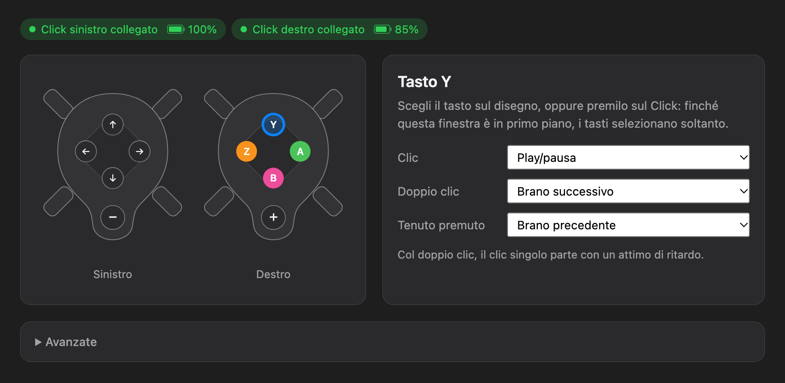
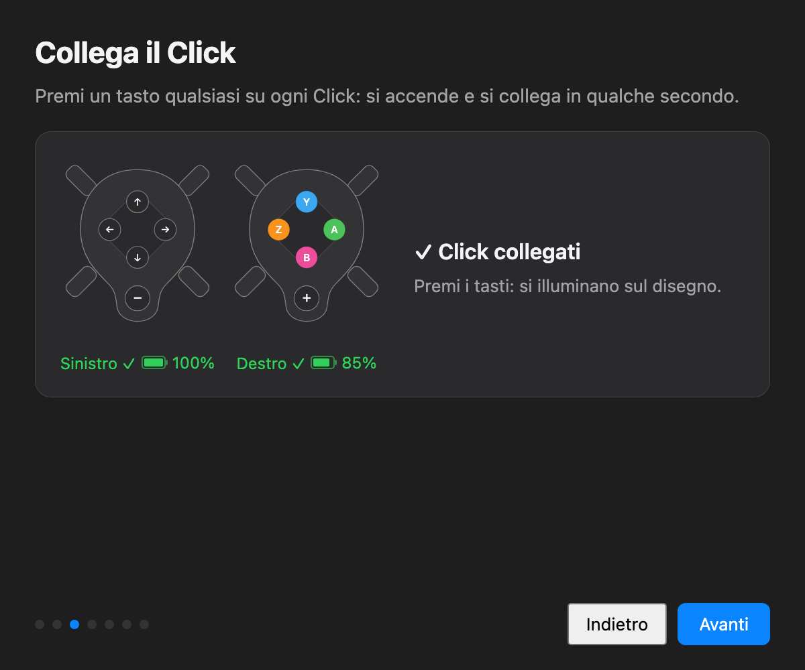
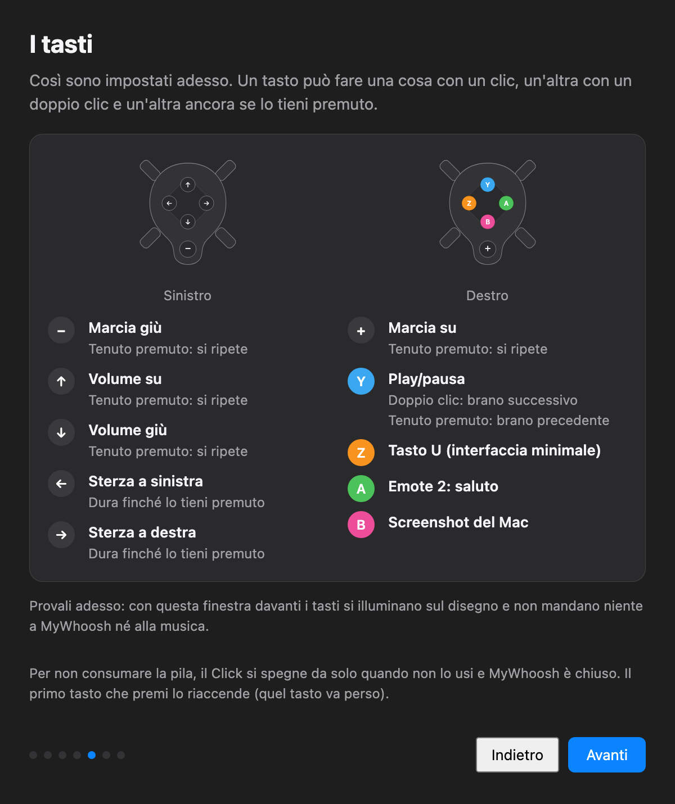

# Click2Whoosh

[English](README.md) · **Italiano**

Usa i controller **Zwift Click v2** con **MyWhoosh** su Mac: marce, sterzo, musica e altro, senza
l'app Zwift. Un'app per la barra dei menu, scritta in Python.



| Collegamento | Tasti |
|---|---|
|  |  |

## Cosa fa
- **Tutti e due i Click** (sinistro e destro), tenuti accesi senza l'app Zwift e fatti spegnere quando non servono, per non consumare la pila.
- **Marce e sterzo a MyWhoosh via rete** con [OpenBikeControl](https://github.com/OpenBikeControl/openbikecontrol-protocol): funzionano anche se MyWhoosh non è in primo piano. Se la rete manca, ripiegano sulla tastiera.
- **Ogni tasto configurabile** con clic, doppio clic e pressione lunga: marce, sterzo, musica, volume, emote, interfaccia minimale di MyWhoosh, screenshot.
- **Finestra di benvenuto** che fa dare i permessi uno alla volta e spiega tasti e menu; **Impostazioni** col disegno dei Click che si illumina quando premi un tasto.
- Batteria di ogni Click, suono a ogni cambio marcia (il Click v2 non vibra), avvisi per pila scarica, MyWhoosh scollegato o firmware cambiato.

L'interfaccia è in italiano e in inglese, secondo la lingua del Mac. Altre lingue sono benvenute: vedi [CONTRIBUTING.md](CONTRIBUTING.md#translations) (in inglese).

## Tasti di default
| Click | Tasto | Clic | Doppio clic | Tenuto premuto |
|---|---|---|---|---|
| Sinistro | − | marcia giù | | ripete |
| Sinistro | ← / → | sterzo | | sterza finché tieni |
| Sinistro | ↑ / ↓ | volume su / giù | | ripete |
| Destro | + | marcia su | | ripete |
| Destro | Y | play/pausa | brano successivo | brano precedente |
| Destro | Z | interfaccia minimale di MyWhoosh | | |
| Destro | A | emote "saluto" | | |
| Destro | B | screenshot del Mac | | |

Col solo Click destro: **+** marcia su, **B** marcia giù, **Z/A** sterzo, **Y** musica.

## Installazione
1. Scarica `Click2Whoosh.dmg` dalla pagina **Releases** e trascina l'app in Applicazioni.
2. L'app non è notarizzata da Apple: al primo avvio apri Impostazioni di Sistema → Privacy e sicurezza → **Apri comunque**.
3. La finestra di benvenuto ti guida nei permessi (Bluetooth, Rete locale, Accessibilità) e nel collegamento.
4. In MyWhoosh, una volta sola: schermata **Connessioni** → icona **OpenBikeControl** in alto a destra → **Click2Whoosh** → **Sì**.

Richiede macOS 11 o successivo (provata su macOS 27, Click v2 firmware 1.1.0, MyWhoosh 5.7.0).
**Il firmware 1.2.0 non è ancora verificato.** Le sue note non citano cambi di protocollo, ma Zwift non permette di tornare alla 1.1.0, quindi non aggiorno i miei Click. Se hai già la 1.2.0, [dimmi se funziona](../../issues/new?template=firmware.md): con un firmware diverso dalla 1.1.0 l'app mostra un avviso, e il registro (menu → Apri registro) dice dove si rompe.

## Dal codice sorgente (Python 3.11+)
```bash
python3 -m venv .venv
.venv/bin/pip install -r requirements-dev.txt
.venv/bin/pybabel compile -d src/locale -D click2whoosh   # traduzioni (senza: solo inglese)
.venv/bin/python src/app.py                 # l'app, con icona nella barra dei menu
.venv/bin/python -m unittest discover tests # test, senza bisogno del Click
packaging/build.sh                          # Click2Whoosh.app e .dmg in packaging/dist
```
Da Terminale i permessi Bluetooth e Accessibilità vanno dati al Terminale. `build.sh` firma l'app con un
certificato del Portachiavi chiamato "Click2Whoosh", se c'è (Accesso Portachiavi → Assistente Certificato →
Crea un certificato… → Primo livello autofirmato, Firma del codice): così i permessi restano tra una build e
l'altra. Altrimenti firma ad-hoc.

Configurazione: `~/Library/Application Support/Click2Whoosh/config.toml` (modello in `src/config.toml`).
Registro: `~/Library/Logs/Click2Whoosh/click2whoosh.log`, anche dal menu "Apri registro".
Per provare un'altra lingua: `C2W_LANG=en .venv/bin/python src/app.py`.

## Come funziona
Protocollo del Click v2, sequenza che lo tiene acceso, cosa accetta MyWhoosh e dettagli di macOS:
[docs/HOW-IT-WORKS.md](docs/HOW-IT-WORKS.md) (in inglese).

## Ringraziamenti
- [BikeControl](https://github.com/OpenBikeControl/bikecontrol): il protocollo del Click v2 è ricavato dalle sue parti pubbliche e dal traffico Bluetooth osservato. Il codice di Click2Whoosh è scritto da zero. Se ti serve più di questo (Windows, iPhone, Android, altri controller e altre app) usa BikeControl.
- [OpenBikeControl](https://github.com/OpenBikeControl/openbikecontrol-protocol), il protocollo aperto con cui MyWhoosh riceve i comandi.
- Sviluppato con l'aiuto di [Claude](https://claude.com/claude-code), l'assistente AI di Anthropic.

Progetto indipendente, non affiliato a Zwift né a MyWhoosh. Zwift Click e MyWhoosh sono marchi dei rispettivi proprietari.

## Licenza
[PolyForm Noncommercial 1.0.0](LICENSE.md): puoi usarlo, studiarlo e modificarlo per scopi non commerciali.
