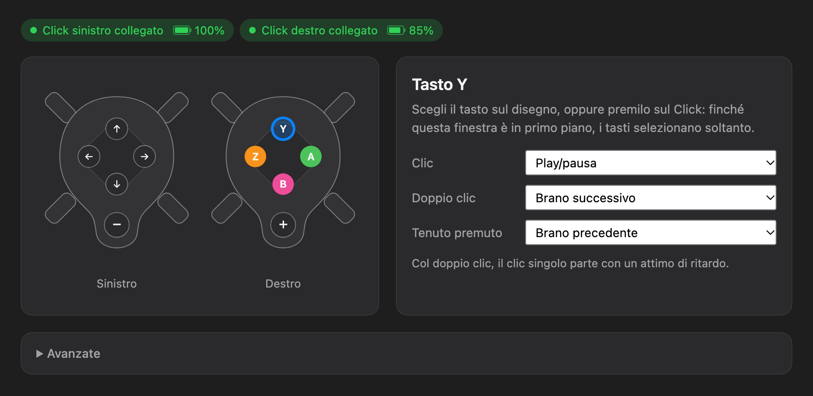
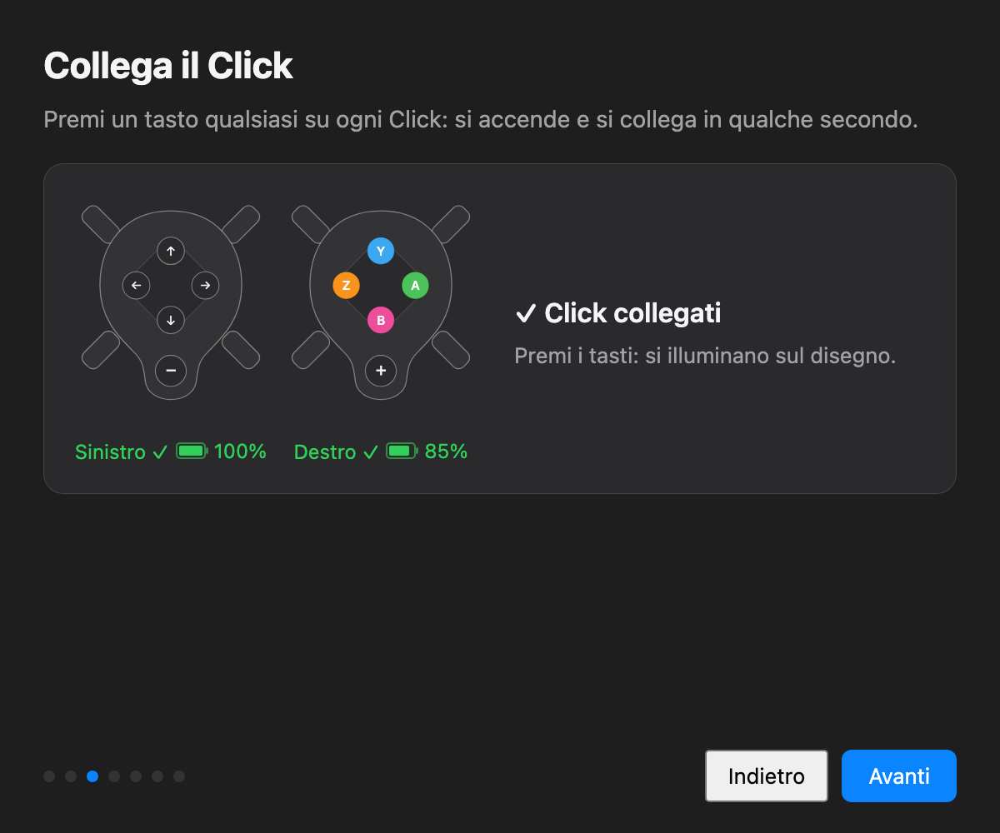
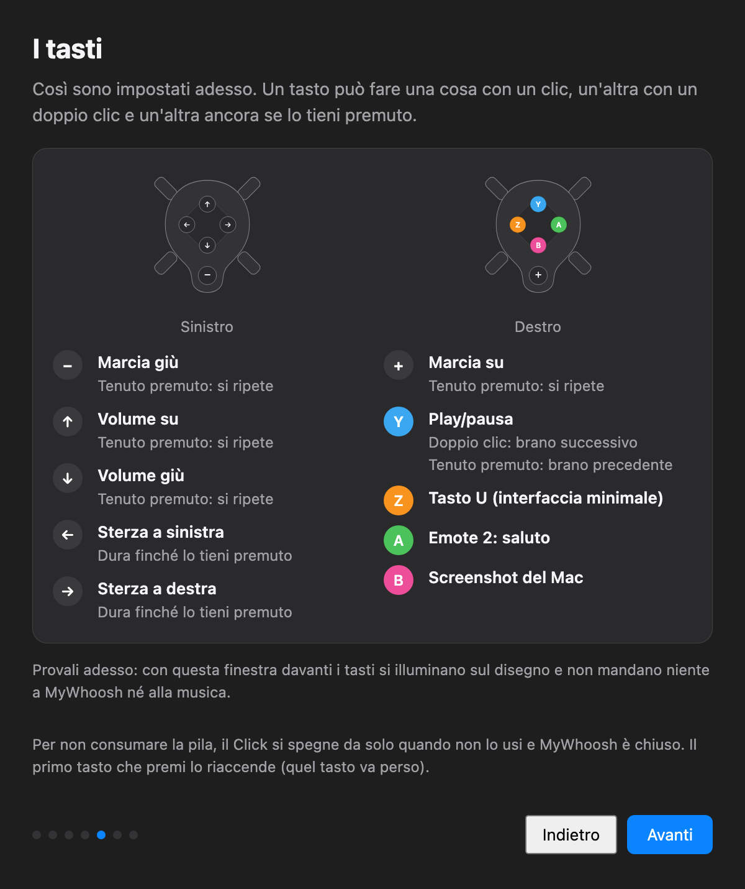

# Click2Whoosh

**English** · [Italiano](README.it.md)

Use **Zwift Click v2** controllers with **MyWhoosh** on a Mac: gears, steering, music and more, without
the Zwift app. A menu bar app written in Python.



| Connecting | Buttons |
|---|---|
|  |  |

## Features
- **Both Clicks** (left and right), kept awake without the Zwift app and switched off when not needed, to save battery.
- **Gears and steering sent to MyWhoosh over the network** with [OpenBikeControl](https://github.com/OpenBikeControl/openbikecontrol-protocol): they work even when MyWhoosh is not in front, with a keyboard fallback.
- **Every button configurable** for click, double click and long press: gears, steering, music, volume, emotes, MyWhoosh's minimal UI, screenshots.
- **Welcome window** that asks for permissions one at a time and explains buttons and menu; **Settings** with a drawing of the Clicks that lights up as you press them.
- Battery of each Click, a sound on every shift (the Click v2 does not vibrate), alerts for low battery, MyWhoosh disconnected or changed firmware.

The app's interface is in Italian.

## Default buttons
| Click | Button | Click | Double click | Long press |
|---|---|---|---|---|
| Left | − | shift down | | repeats |
| Left | ← / → | steer | | steers while held |
| Left | ↑ / ↓ | volume up / down | | repeats |
| Right | + | shift up | | repeats |
| Right | Y | play/pause | next track | previous track |
| Right | Z | MyWhoosh minimal UI | | |
| Right | A | "wave" emote | | |
| Right | B | Mac screenshot | | |

With the right Click only: **+** shift up, **B** shift down, **Z/A** steer, **Y** music.

## Install
1. Download `Click2Whoosh.dmg` from **Releases** and drag the app to Applications.
2. The app is not notarized by Apple: on first launch open System Settings → Privacy & Security → **Open Anyway**.
3. The welcome window guides you through permissions (Bluetooth, Local Network, Accessibility) and pairing.
4. In MyWhoosh, once: **Connections** screen → **OpenBikeControl** icon at the top right → **Click2Whoosh** → **Yes**.

Requires macOS 11 or later (tested on macOS 27, Click v2 firmware 1.1.0, MyWhoosh 5.7.0).
**Don't update the Click's firmware**: an update may change the protocol (the app warns you if it happens).

## From source (Python 3.11+)
```bash
python3 -m venv .venv
.venv/bin/pip install -r requirements.txt
.venv/bin/python src/app.py                 # the app, with its menu bar icon
.venv/bin/python -m unittest discover tests # tests, no hardware needed
packaging/build.sh                          # Click2Whoosh.app and .dmg in packaging/dist
```
From Terminal, the Bluetooth and Accessibility permissions go to the Terminal app. `build.sh` signs the app
with a keychain certificate named "Click2Whoosh" if present (Keychain Access → Certificate Assistant →
Create a Certificate… → Self-Signed Root, Code Signing), so permissions survive rebuilds; otherwise ad-hoc.

Configuration: `~/Library/Application Support/Click2Whoosh/config.toml` (template in `src/config.toml`).
Log: `~/Library/Logs/Click2Whoosh/click2whoosh.log`, also from the menu.

## How it works
The Click v2 Bluetooth protocol, the sequence that keeps it awake, what MyWhoosh accepts and the macOS
details: [docs/HOW-IT-WORKS.md](docs/HOW-IT-WORKS.md).

## Credits
- [BikeControl](https://github.com/OpenBikeControl/bikecontrol): the Click v2 protocol comes from its public sources and from observing Bluetooth traffic. Click2Whoosh's code is written from scratch. If you need more (Windows, iPhone, Android, other controllers and apps), use BikeControl.
- [OpenBikeControl](https://github.com/OpenBikeControl/openbikecontrol-protocol), the open protocol MyWhoosh uses to receive commands.
- Built with the help of [Claude](https://claude.com/claude-code), Anthropic's AI assistant.

Independent project, not affiliated with Zwift or MyWhoosh. Zwift Click and MyWhoosh are trademarks of their respective owners.

## License
[PolyForm Noncommercial 1.0.0](LICENSE.md): free to use, study and modify for noncommercial purposes.
